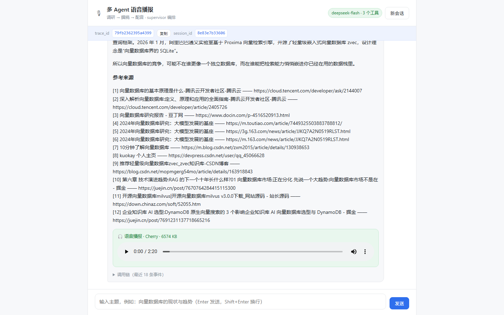

# 多 Agent 语音播报系统（MultiAgentVoice）

> 输入一个主题，三个 Agent 协作产出一期**可播放的语音播报**。
>
> **LangGraph（supervisor 编排）· 千问 TTS（自实现工具协议）· FastAPI · 原生 Web 界面**



---

## 一、这是什么

这是一个**多 Agent 协同**的对话式应用。用户在浏览器里输入一个主题，比如
「向量数据库的现状与趋势」，系统会在 40–90 秒内完成四个阶段：

| 阶段 | 执行者 | 做什么 | 产出 |
| --- | --- | --- | --- |
| ① | **调研 Agent** | 拆 3 个检索词 → 联网搜索 → 打开前 2 篇原文 | 带引用的要点笔记 |
| ② | **撰稿 Agent** | 把笔记改写成口语化口播稿 | 500 字左右的稿子 |
| ③ | **配音 Agent** | 调**千问 TTS** 合成语音 | `.wav` 音频（真实可播放） |
| ④ | **汇总** | 拼成一份完整回复 | 要点 / 播报 / 稿 / 来源 |

最终产物里包含**真实服务生成的音频**，不是占位文件、不是 mock。

### 为什么做这个场景

语音播报天然需要"调研 → 写作 → 配音"三种不同的能力，正好对应三类节点：
工具型 Agent（联网检索）、LLM 人设 Agent（撰稿）、工具型 Agent（TTS）。
既满足"至少 3 个 agent、至少 2 种能力来源、产物含非纯文本"的要求，
又不像"多角色聊天"那样容易变成纯 prompt 拼接。

### 技术栈

| 层 | 选型 |
| --- | --- |
| 编排 | **LangGraph**（StateGraph + 条件边，supervisor 模式） |
| 大模型 | DeepSeek / 千问（OpenAI 兼容端点，改 `.env` 即可切换） |
| 语音合成 | **千问 qwen3-tts-flash**（自实现工具协议 client） |
| 联网检索 | 博查 Web Search API |
| 正文抽取 | trafilatura |
| 后端 | FastAPI + Uvicorn |
| 前端 | 原生 HTML / CSS / JS（零框架依赖） |
| 可观测 | trace_id + JSON Lines 日志 |

---

## 二、功能特性

- **supervisor 中心调度**：一个调度节点按状态分派给专职 worker，链路清晰、可重试、可降级
- **新增工具协议**：千问 TTS 不是 OpenAI 协议，独立实现 `QwenTTSClient`，只写两个翻译函数
- **模板方法工具层**：鉴权 / 超时 / 状态码 / 错误脱敏只写一次，新增协议约 60 行
- **真实音频产物**：`Artifact(kind="audio")`，前端用 `<audio>` 直接播放
- **流式进度**：`POST /chat` 立即返回 trace_id，前端轮询展示"调研 → 撰稿 → 配音"
- **全链路可观测**：`logs/agent.log` 每行一条 JSON，含 run / node / llm / tool 四层 span
- **配置驱动**：agent 与工具在 `config.yaml` 编排，换服务商只改 `.env`
- **密钥纪律**：配置里只允许出现环境变量名；把 Key 粘进 `config.yaml` 会**启动失败**
- **错误可读**：422 / 500 / 超时都有中文提示，界面不白屏

---

## 三、系统架构

### 图结构（supervisor 模式）

```
                    ┌──────────────┐
        ┌──────────►│  supervisor  │◄──────────┐
        │           └──────┬───────┘           │
        │                  │ 条件边：读 state["next_worker"]
        │      ┌───────────┼───────────┐       │
        │      ▼           ▼           ▼       │
        │  researcher    writer      voice ────┘
        │      │           │           │
        └──────┴───────────┴───────────┘
                           │ next_worker == "finish"
                           ▼
                        finish → END
```

调度规则（`podcast_agent/graph/nodes.py`）：

```python
if not notes:                     next = "researcher"   # 没资料
elif not script:                  next = "writer"       # 没稿
elif not audio and attempts < 2:  next = "voice"        # 没音频（最多试 2 次）
else:                             next = "finish"
```

**为什么不用另外两种模式：**

| 模式 | 特点 | 结论 |
| --- | --- | --- |
| **supervisor** | 中心节点按状态分派 | ✅ **采用**：阶段依赖明确，决策集中且可观测，能重试/降级 |
| pipeline | 固定顺序的边 | ❌ 出错无法重试，也无法跳过（配音挂了就没法只交付文字稿） |
| network | worker 自由转交 | ❌ 链路难讲清楚，容易"踢皮球"，调试成本高 |

### 请求链路

```
浏览器 ──POST /chat──► FastAPI ──► BackgroundTask
                         │              │
                         │◄──trace_id───┘ 立即返回
                         │
浏览器 ──GET /chat/{trace_id}──► 轮询状态（stage / answer / artifacts）
                         │
浏览器 ──GET /files/xxx.wav──► 播放音频
```

---

## 四、快速开始

### 1. 安装依赖

```bash
cd agent
python -m venv .venv

# Windows
.venv\Scripts\activate
# macOS / Linux
source .venv/bin/activate

pip install -r requirements.txt
```

### 2. 配置密钥

```bash
cp .env.example .env
```

填入三个值（`.env` 已被 `.gitignore` 排除，不会进 Git）：

| 变量 | 用途 | 获取地址 |
| --- | --- | --- |
| `DEEPSEEK_API_KEY` | 大模型 | <https://platform.deepseek.com> |
| `BOCHA_API_KEY` | 联网搜索 | <https://open.bocha.cn> |
| `DASHSCOPE_API_KEY` | 千问 TTS | <https://bailian.console.aliyun.com> |

> 想用千问当大模型？把 `LLM_BASE_URL` / `LLM_MODEL` 改成百炼兼容端点，
> `DEEPSEEK_API_KEY` 填百炼 Key 即可，**代码不用动**。

### 3. 启动

```bash
python run.py
```

看到 `Uvicorn running on http://127.0.0.1:8010` 即成功。

### 4. 打开界面

<http://127.0.0.1:8010>

### 5. 自检（演示前建议跑一次）

```bash
curl http://127.0.0.1:8010/health
```

`key_ready` 全为 `true`、`protocols` 含 `qwen_tts`，说明环境就绪。

---

## 五、目录结构

```
agent/
├─ config.yaml                 # 编排：agent / tools / graph 模式
├─ .env.example                # 密钥模板（.env 已 gitignore）
├─ requirements.txt
├─ run.py                      # 启动入口（默认 8010）
├─ podcast_agent/
│  ├─ config.py                # config.yaml + .env 加载 + 密钥泄漏校验
│  ├─ llm.py                   # OpenAI 兼容 chat 封装
│  ├─ observability.py         # trace_id + JSON Lines 日志
│  ├─ artifacts.py             # Artifact（audio / image）
│  ├─ util.py                  # 脱敏 / 截断 / 时间
│  ├─ tools/
│  │  ├─ base.py               # ★ 模板方法基类
│  │  ├─ registry.py           # 协议注册表
│  │  ├─ bocha.py              # 联网搜索协议
│  │  ├─ readability.py        # 网页正文抽取协议
│  │  └─ qwen_tts.py           # ★ 本组新增：千问 TTS 协议
│  ├─ graph/
│  │  ├─ state.py              # AgentState
│  │  ├─ nodes.py              # supervisor + 3 worker + finish
│  │  ├─ build.py              # 图的组装（条件边）
│  │  └─ runner.py             # 一次执行
│  └─ api/app.py               # /chat、轮询、/files、/logs、/health
├─ web/                        # 单页对话界面
├─ docs/
│  ├─ 设计说明.md               # 详细设计文档
│  └─ ui-screenshot.png        # 界面截图
├─ data/outputs/               # 生成的音频
└─ logs/agent.log              # JSON Lines 调用链
```

---

## 六、接口

| 方法 | 路径 | 说明 |
| --- | --- | --- |
| POST | `/chat` | `{message, session_id?}` → `{trace_id, session_id, status}`，立即返回 |
| GET | `/chat/{trace_id}` | 轮询：`stage` / `answer_md` / `answer_html` / `artifacts` / `events` |
| GET | `/files/{name}` | 播放生成的音频（带目录穿越防护） |
| GET | `/logs?trace_id=` | 读回 JSONL 日志 |
| GET | `/health` | 密钥与协议自检 |

**为什么是「提交 + 轮询」而不是一次请求等结果：**
单次生成 40–90 秒，长连接既容易超时，也没法展示 supervisor 的阶段进展。
先拿 `trace_id` 再轮询，界面就能实时显示"调研 Agent 正在检索资料 → 撰稿 Agent 正在写口播稿"。

---

## 七、设计要点

更详细的说明见 **[docs/设计说明.md](docs/设计说明.md)**，这里只列结论：

1. **模板方法收敛协议差异**
   `ToolClient.call()` 固定"构造请求 → 发送 → 解析响应"三段，子类只实现两个翻译函数；
   鉴权、超时、状态码、脱敏只写一次。

2. **千问 TTS 必须新增协议**
   它不是 OpenAI 的 `/v1/audio/speech`：请求体结构不同，返回是 **JSON + 24 小时有效的 OSS 链接**
   而不是音频流。所以 `_parse_response` 要自己**流式下载落盘**，并守住 `MAX_AUDIO_BYTES`。

3. **带签名的链接绝不外泄**
   `sanitize()` 抹掉 `sk-*` / `Bearer *` / `Signature=` / `OSSAccessKeyId=`；
   日志里只出现 `oss://…(已隐藏签名)`。

4. **配置纪律是硬约束**
   `config.py` 加载时扫描 `config.yaml`：发现 `sk-` 形态或与真实环境变量同值，直接抛错。

5. **长任务用轮询而非长连接**
   既避免超时白屏，也让阶段进度可视化。

---

## 八、常见问题

**Q：第一次生成很慢，是不是卡住了？**
A：正常。调研（多次搜索 + 抓原文）+ 撰稿 + TTS 合计 40–90 秒。界面会显示阶段进度。

**Q：音频好大？**
A：千问返回的是未压缩 WAV，500 字稿约 4–6 MB / 2 分钟。想更小可在 `qwen_tts.py` 里做转码，
或缩短 `config.yaml` 中的 `writer.max_chars`。

**Q：换大模型要改代码吗？**
A：不用。只改 `.env` 的 `LLM_BASE_URL` / `LLM_MODEL` / `DEEPSEEK_API_KEY` 三行。

**Q：端口 8010 被占用？**
A：`netstat -ano | findstr :8010` 找 PID，`taskkill /PID <PID> /F`；
或 `set PORT=8011 && python run.py`。

**Q：重启后 trace_id 查不到了？**
A：运行状态在内存里（课程演示够用）。日志文件仍在，可以用 `grep <trace_id> logs/agent.log` 查历史。

**Q：`/health` 显示 key_ready=false？**
A：对应 Key 没填或没被加载。检查 `.env` 是否在项目根目录、变量名是否拼对。

---

## 九、已知限制与后续

- 运行记录在内存，重启即失效（生产应落库）
- 音频未压缩，未做转码
- 未接图片生成（场景聚焦"调研 + 播报"）
- 未接 Langfuse（用 JSONL + trace_id 满足链路复核要求）
- 未做 X-API-Key 鉴权与限流（属加分项）

---

## 十、提交物

| 项 | 说明 |
| --- | --- |
| 代码 | 本仓库，`config.yaml` + README 即设计说明 |
| 录屏 | 6–8 分钟，四段结构：端到端演示 / 架构讲解 / 可观测性证据 / 分工自述 |
| 验收记录 | 现场演示通过后由教师签字 |

### 分工（待填）

| 成员 | 承担模块 |
| --- | --- |
|  | 编排与配置（`config.yaml`、`graph/`） |
|  | 工具协议扩展（`tools/`，含 `qwen_tts`） |
|  | 前端界面（`web/`） |
|  | 测试与文档（`docs/`、验证脚本） |
